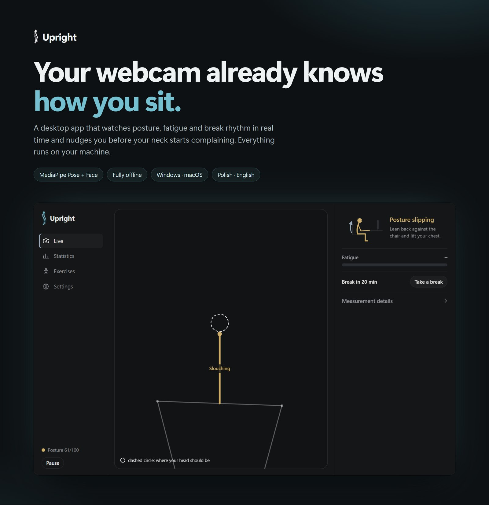
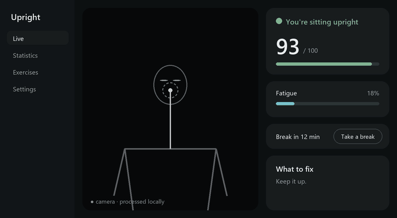
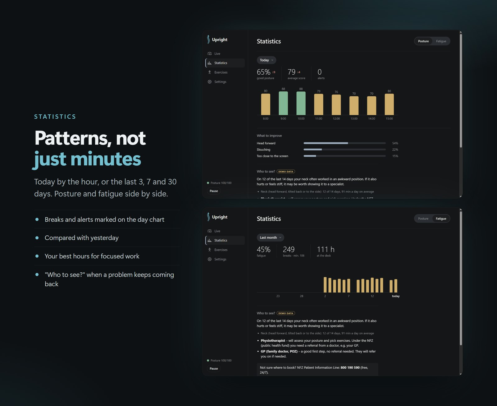
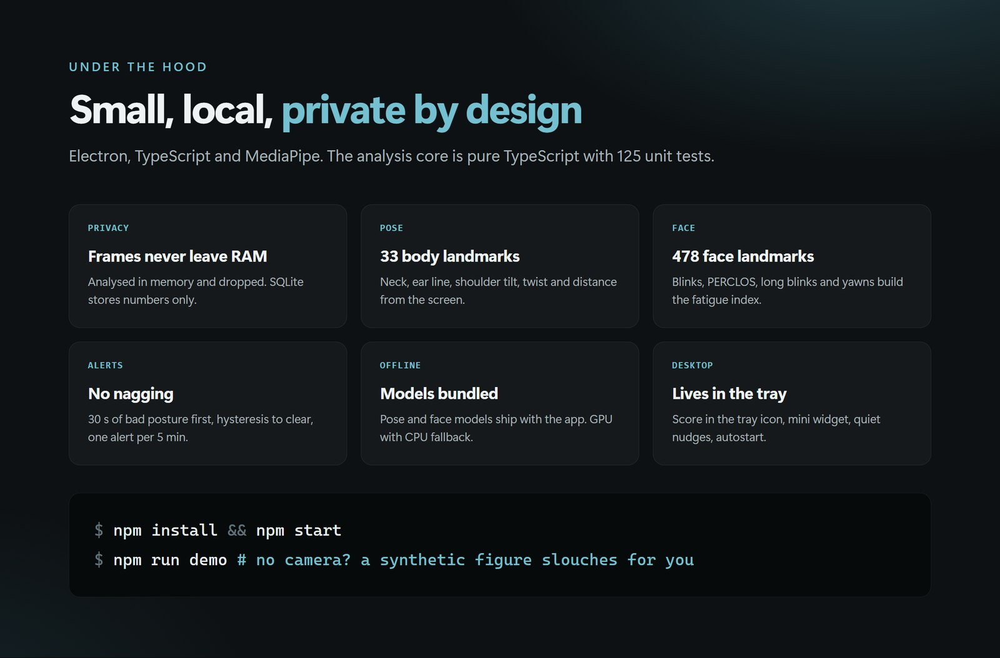

<p align="center"></p>

<p align="center"></p>

<p align="center"></p>

<p align="center"></p>

<p align="center"></p>

<p align="center"></p>

<p align="center"></p>

<details>
<summary><b>Run it</b></summary>

<br>

Node.js 22.13+ and a webcam.

```bash
npm install
npm start          # build and open the app
npm run demo       # no camera: a synthetic figure that slouches now and then
npm run seed-demo  # 12 days of sample data, then: npm run demo:stats
npm test           # unit tests for the analysis core
npm run dist:win   # installer (.exe), or dist:mac for a .dmg
```

</details>

<details>
<summary><b>How the score works</b></summary>

<br>

Every metric is measured against your own calibration, from a camera on top of the monitor.

| Metric | Measured as | Warning at |
| --- | --- | --- |
| Head forward | nose to shoulder line ÷ shoulder width, plus head pitch | 15% drop |
| Head tilted back | head pitch above calibration | 15° |
| Slouching | ear line above shoulders ÷ shoulder width | 10% drop |
| Shoulders raised | shoulders moving up towards the ears | 15% drop |
| Shoulder tilt | angle of the shoulder line | 5° |
| Too close to the screen | distance between the eyes | 15% larger face |
| Head tilt | angle of the eye line | 10° |
| Torso twist | shoulder width ÷ eye distance | 15% drop |
| Sitting still | head movement over 5 min | almost none for 30 min |

Score = 100 × (1 − weighted penalties ÷ 0.6), smoothed over ~12 s. It is a habit tool, not a medical diagnosis.

</details>
