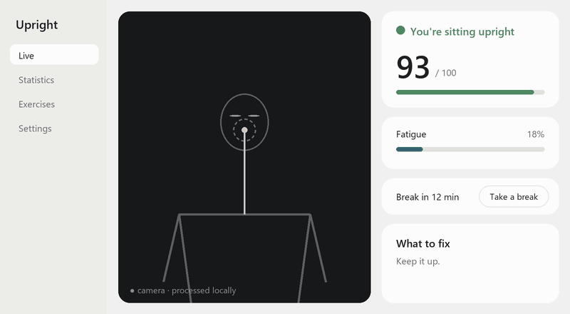
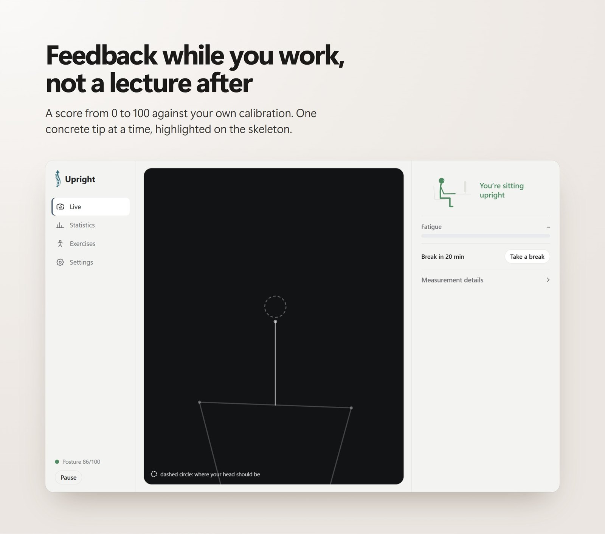
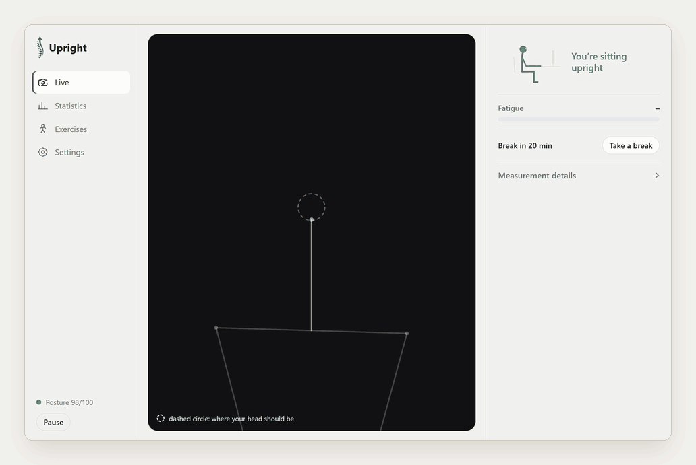
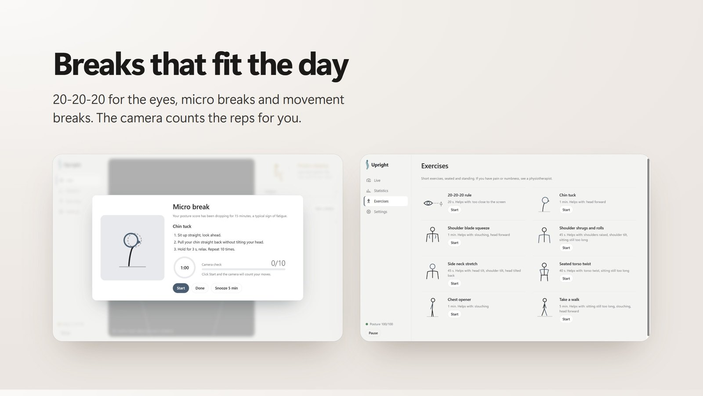
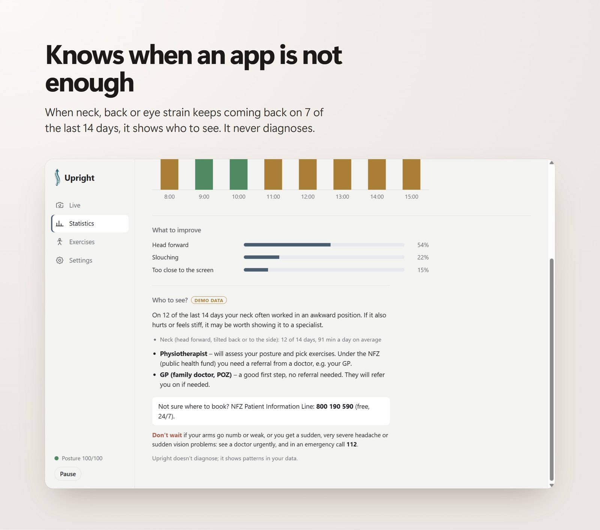
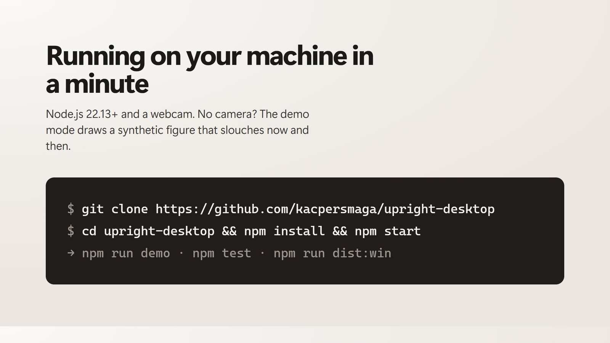

<p align="center"></p>

<p align="center"></p>

<p align="center"></p>

<p align="center"></p>

<p align="center"></p>

<p align="center"></p>

<p align="center"></p>

<p align="center"></p>

<p align="center"></p>

<p align="center">
  
  
  
  
</p>

<details>
<summary><b>Run it</b></summary>

<br>

Node.js 22.13 or newer and a webcam.

```bash
npm install
npm start          # build and open the app
npm run demo       # no camera: a synthetic figure that slouches now and then
npm run seed-demo  # 12 days of sample data in ./demo-data, then: npm run demo:stats
npm test           # unit tests for the analysis core
npm run dist:win   # installer (.exe), or dist:mac for a .dmg
```

The MediaPipe models ship in `assets/models`, so the app works offline. On first start it asks you to calibrate your upright posture; the window closes to the tray and the analysis keeps running.

</details>

<details>
<summary><b>How the score works</b></summary>

<br>

The camera usually sits on the monitor, so it sees you from the front. Every metric is measured against your own calibration:

| Metric | Measured as | Warning at |
| --- | --- | --- |
| Head forward | nose to shoulder line ÷ shoulder width, plus head pitch | 15% drop |
| Head tilted back | head pitch above calibration | 15° |
| Slouching | ear line above shoulders ÷ shoulder width | 10% drop |
| Shoulders raised | shoulders moving up towards the ears | 15% drop |
| Shoulder tilt | angle of the shoulder line | 5° |
| Too close to the screen | distance between the eyes in pixels | 15% larger face |
| Head tilt | angle of the eye line | 10° |
| Torso twist | shoulder width ÷ eye distance | 15% drop |
| Sitting still | head movement over 5 min | almost none for 30 min |

Score = 100 × (1 − weighted penalties ÷ 0.6), smoothed over about 12 s. Fatigue combines PERCLOS, blink rate, long blinks, yawns, posture trend and time since the last break, and is hidden when the eye data is unreliable. It is a habit tool, not a medical diagnosis.

</details>
